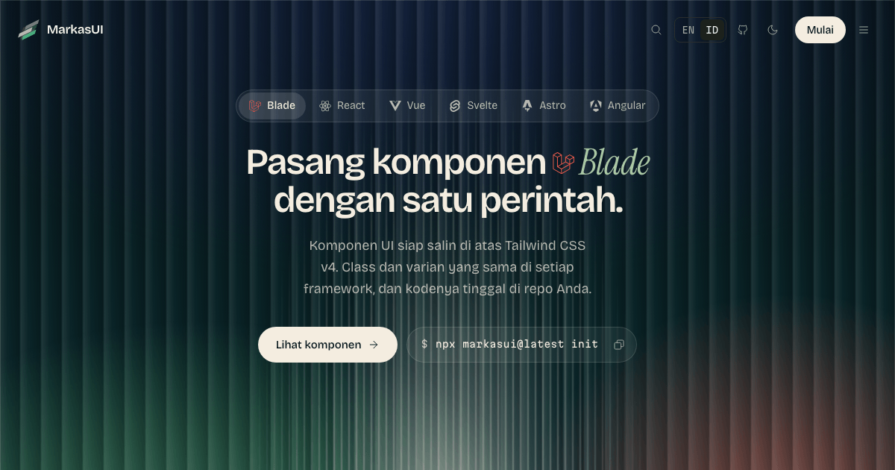

<div align="center">

<a href="https://markas.jenderalcorp.com"></a>

# MarkasUI

**Komponen UI Tailwind CSS v4 untuk Laravel Blade, React, Vue, Svelte, Astro, dan Angular.**
Satu desain, enam framework, disalin ke project Anda dengan satu perintah.

[Website](https://markas.jenderalcorp.com/id) · [Komponen](https://markas.jenderalcorp.com/id/components) · [Template](https://markas.jenderalcorp.com/id/templates) · [Pages](https://markas.jenderalcorp.com/id/pages) · [Docs](https://markas.jenderalcorp.com/id/docs/introduction) · [English](README.md)

[](https://www.npmjs.com/package/markasui)
[](https://www.npmjs.com/package/@markasui/mcp)
[](https://github.com/ahmad-rian/markasui/actions/workflows/ci.yml)
[](LICENSE)

</div>

## Isi

- [Kenapa MarkasUI](#kenapa-markasui)
- [Mulai cepat](#mulai-cepat)
- [Panduan per framework](#panduan-per-framework)
- [Referensi CLI](#referensi-cli)
- [Dipakai bersama AI agent (MCP)](#dipakai-bersama-ai-agent-mcp)
- [Isi library](#isi-library)
- [Tema dan mode gelap](#tema-dan-mode-gelap)
- [Kualitas](#kualitas)
- [Develop di lokal](#develop-di-lokal)
- [Lisensi](#lisensi)

## Kenapa MarkasUI

- **Komponen yang sama di mana saja.** 106 komponen dengan class, varian, dan tampilan yang identik di Blade, React, Vue, Svelte, Astro, dan Angular. Tes kesamaan visual membandingkan setiap framework dengan React di setiap perubahan.
- **Kodenya milik Anda.** CLI menyalin file source biasa ke project Anda. Tanpa paket runtime, tanpa `clsx`, tanpa `tailwind-merge`, tanpa paket ikon.
- **Ringan.** Setiap komponen React dan Vue di bawah 3 KB JS gzip, dan budget ukuran untuk semua framework dicek di CI.
- **Elemen native dulu.** `<dialog>`, Popover API, dan `<details>` sebelum JavaScript buatan sendiri.
- **Aksesibel.** WCAG 2.2 AA dicek dengan axe dan tes keyboard di CI.
- **Siap Laravel dan Livewire.** Komponen Blade memakai Alpine.js, jalan dengan `wire:model`, dan diuji di aplikasi Livewire 3 dan 4 sungguhan.
- **Dibuat untuk AI agent.** Server MCP, Agent Skill, registry JSON, dan `llms.txt`.

## Mulai cepat

Syarat: Node 20 ke atas dan Tailwind CSS v4 di project Anda.

```bash
npx markasui@latest init          # deteksi framework, tulis markas.json dan markas.css
npx markasui@latest add button modal input
```

Pakai package manager lain? `pnpm dlx markasui@latest init`, `yarn dlx markasui@latest init`, dan `bunx markasui@latest init` sama saja.

Selesai. Import `markas.css` sekali (output `init` menunjukkan di mana), lalu pakai komponennya:

```tsx
import { Button } from "@/components/markas/Button";

export default function Page() {
  return <Button variant="secondary">Save draft</Button>;
}
```

Jalankan `npx markasui list` untuk melihat semua komponen, atau lihat preview langsungnya di [markas.jenderalcorp.com/id/components](https://markas.jenderalcorp.com/id/components).

## Panduan per framework

`init` mendeteksi stack Anda (`artisan` untuk Laravel, selain itu `package.json`) lalu memilih folder di bawah. Ubah lewat `markas.json`, atau pakai `--framework`.

| Stack                     | Dideteksi dari            | Komponen ditulis ke                              | File tema                                  |
| ------------------------- | ------------------------- | ------------------------------------------------ | ------------------------------------------ |
| Laravel (Blade, Livewire) | `artisan`                 | `resources/views/components/markas`              | `resources/css/markas.css`                 |
| Next.js                   | `next`                    | `src/components/markas` atau `components/markas` | `src/app/markas.css` atau `app/markas.css` |
| React + Vite              | `react`                   | `src/components/markas`                          | `src/markas.css`                           |
| Nuxt                      | `nuxt`                    | `components/markas`                              | `assets/css/markas.css`                    |
| Vue + Vite                | `vue`                     | `src/components/markas`                          | `src/markas.css`                           |
| SvelteKit / Svelte        | `@sveltejs/kit`, `svelte` | `src/lib/components/markas`                      | `src/markas.css`                           |
| Astro                     | `astro`                   | `src/components/markas`                          | `src/styles/markas.css`                    |
| Angular                   | `@angular/core`           | `src/app/markas`                                 | `src/markas.css`                           |

<details>
<summary><b>Laravel Blade dan Livewire</b></summary>

```bash
npx markasui@latest init
npx markasui@latest add button input modal
```

```blade
<x-markas.input label="Email" type="email" wire:model.live="email" />
<x-markas.button variant="primary" wire:click="save">Save</x-markas.button>
```

Dengan Livewire 3 atau 4, jangan memuat Alpine.js terpisah karena Livewire sudah membawanya. Komponen form menerima `wire:model` (termasuk `.live` dan `.debounce`), dialog bisa dibuka dari server dengan `wire:model="showModal"`, dan id tetap stabil saat render ulang. Baca [panduan Livewire](https://markas.jenderalcorp.com/id/docs/livewire).

</details>

<details>
<summary><b>React dan Next.js</b></summary>

```tsx
import { Button } from "@/components/markas/Button";
import { Modal } from "@/components/markas/Modal";
```

Komponen tanpa state bisa dipakai sebagai React Server Component; yang interaktif diawali `"use client"`. [Panduan React](https://markas.jenderalcorp.com/id/frameworks/react)

</details>

<details>
<summary><b>Vue dan Nuxt</b></summary>

```vue
<script setup lang="ts">
import Button from "@/components/markas/Button.vue";
</script>

<template>
  <Button variant="secondary">Cancel</Button>
</template>
```

Binding dua arah memakai `v-model`. [Panduan Vue](https://markas.jenderalcorp.com/id/frameworks/vue)

</details>

<details>
<summary><b>Svelte dan SvelteKit</b></summary>

```svelte
<script lang="ts">
  import Button from "$lib/components/markas/Button.svelte";
</script>

<Button variant="secondary">Cancel</Button>
```

Ditulis dengan Svelte 5 runes; nilai dua arah memakai `bind:value`. [Panduan Svelte](https://markas.jenderalcorp.com/id/frameworks/svelte)

</details>

<details>
<summary><b>Astro</b></summary>

```astro
---
import Button from "@/components/markas/Button.astro";
---

<Button variant="secondary">Cancel</Button>
```

Dirender di server; komponen interaktif hanya menambah satu script vanilla kecil per halaman, tanpa runtime framework. [Panduan Astro](https://markas.jenderalcorp.com/id/frameworks/astro)

</details>

<details>
<summary><b>Angular</b></summary>

```ts
import { Component } from "@angular/core";
import { Button } from "./markas/button.component";

@Component({
  selector: "app-actions",
  imports: [Button],
  template: `<button markas-button variant="secondary">Cancel</button>`,
})
export class Actions {}
```

Standalone component dengan signals; komponen satu elemen memakai attribute selector sehingga atribut native tetap di elemen itu. [Panduan Angular](https://markas.jenderalcorp.com/id/frameworks/angular)

</details>

## Referensi CLI

```
npx markasui init                 deteksi framework, buat markas.json, salin markas.css
npx markasui add <name...>        tulis komponen ke folder komponen
npx markasui list                 daftar semua komponen

--cwd <path>                      folder project (default: folder saat ini)
--framework <name>                blade, react, vue, svelte, astro, atau angular
--overwrite                       timpa file yang berubah tanpa bertanya
-y, --yes                         jawab ya untuk setiap pertanyaan
--registry <url|folder>           registry lain (default https://markas.jenderalcorp.com/r)
```

`add` tidak pernah menimpa perubahan Anda tanpa bertanya (pakai `--overwrite` untuk menimpa), dan menampilkan perintah install kalau komponen butuh paket npm. Panduan lengkap: [docs CLI](https://markas.jenderalcorp.com/id/docs/cli).

## Dipakai bersama AI agent (MCP)

`@markasui/mcp` membuat coding agent Anda bisa mencari komponen dan mengambil kode yang tepat untuk framework Anda.

```bash
# Claude Code
claude mcp add markasui -- npx -y @markasui/mcp

# OpenAI Codex
codex mcp add markasui -- npx -y @markasui/mcp

# Gemini CLI
gemini mcp add markasui npx -- -y @markasui/mcp
```

Sebagian besar tool lain (Cursor, VS Code, Windsurf/Devin, Zed, Antigravity, JenderalCode, Cline, Kiro, dan lainnya) memakai JSON yang sama:

```json
{
  "mcpServers": {
    "markasui": { "command": "npx", "args": ["-y", "@markasui/mcp"] }
  }
}
```

Setup untuk 20 tool: [docs MCP](https://markas.jenderalcorp.com/id/docs/mcp). Ada juga [Agent Skill](https://markas.jenderalcorp.com/id/docs/skills) dan ringkasan teks di [llms.txt](https://markas.jenderalcorp.com/llms.txt). Setiap halaman docs punya tombol Copy page yang memberi agent seluruh halaman dalam Markdown.

## Isi library

- **106 komponen**: form (input, select, combobox, slider, currency input, OTP, file dropzone, prompt input), overlay (modal, drawer, popover, dropdown menu, command palette, hover card), navigasi (navbar, sidebar, tabs, menubar, breadcrumb, pagination, bottom navigation), tampilan data (table, card, badge, avatar, chat message, code block), feedback (toast, alert, progress, skeleton), section halaman (footer, FAQ, logo cloud, 404), serta teks, tombol, dan background beranimasi (aurora, meteors, sparkles, spotlight, marquee, number ticker, dan lainnya).
- **6 template dashboard**: Alur, Kirana, Larisa, Lumen, Pipeline, Rambu. [Lihat](https://markas.jenderalcorp.com/id/templates)
- **8 welcome dan landing page**: Belajar, Catatan, Galeri, Karya, Konek, Konsultan, Studio, Tender. [Lihat](https://markas.jenderalcorp.com/id/pages)

Setiap template dan page tersedia di keenam framework.

## Tema dan mode gelap

Semua warna berasal dari token di [`markas.css`](packages/theme/markas.css) (`--markas-primary`, `--markas-surface`, `--markas-ink`, dan seterusnya). Ubah satu token dan semua komponen ikut. Mode gelap aktif saat `<html>` punya class `dark`. [Panduan tema](https://markas.jenderalcorp.com/id/docs/theming)

## Kualitas

Setiap perubahan dicek di CI:

- Unit test untuk setiap framework (Vitest), sekitar 1.800 tes
- E2e Playwright untuk setiap komponen dan template di keenam framework: kesamaan visual dengan React, axe WCAG 2.2 AA, dan tes keyboard
- Aplikasi Laravel sungguhan dengan Livewire 3 dan 4: render ulang, `wire:model`, `wire:navigate`, dan budget performa
- Budget ukuran untuk setiap komponen dan setiap halaman docs

## Develop di lokal

```bash
pnpm install
pnpm dev          # situs docs di http://localhost:4321
pnpm playground   # halaman uji komponen di http://localhost:5173
pnpm test         # unit test
pnpm test:e2e     # tes komponen Playwright
```

```
apps/docs/          situs docs (Astro), Inggris di / dan Indonesia di /id
components/<name>/  satu folder per komponen: Blade, React, Vue, Svelte, Astro, Angular, meta.json, usage.md
examples/           contoh identik per framework (playground, tes, preview docs)
templates/<slug>/   dashboard dan landing page di keenam framework
packages/theme/     token warna markas.css
packages/registry/  build registry JSON dengan validasi Zod
packages/cli/       paket npm markasui
packages/mcp/       paket npm @markasui/mcp
skills/markasui/    Agent Skill
tests/              tes unit, e2e, docs, dan Livewire
```

Kontribusi sangat terbuka. Baca [CONTRIBUTING.md](CONTRIBUTING.md) dulu, dan laporkan bug atau ide di [GitHub issues](https://github.com/ahmad-rian/markasui/issues).

## Lisensi

[MIT](LICENSE). Dibuat oleh [JenderalCorp](https://jenderalcorp.com) (CV Jenderal Solusi Digital), Purwokerto, Indonesia.
