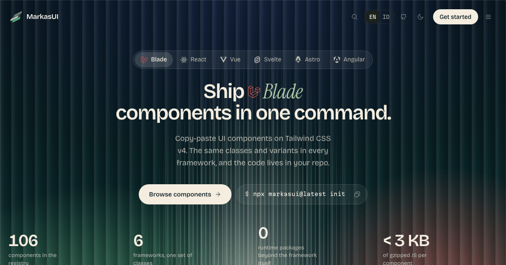

<div align="center">

<a href="https://markas.jenderalcorp.com"></a>

# MarkasUI

**Tailwind CSS v4 UI components for Laravel Blade, React, Vue, Svelte, Astro, and Angular.**
One design, six frameworks, copied into your project with one command.

[Website](https://markas.jenderalcorp.com) · [Components](https://markas.jenderalcorp.com/components) · [Templates](https://markas.jenderalcorp.com/templates) · [Pages](https://markas.jenderalcorp.com/pages) · [Docs](https://markas.jenderalcorp.com/docs/introduction) · [Bahasa Indonesia](README.id.md)

[](https://www.npmjs.com/package/markasui)
[](https://www.npmjs.com/package/@markasui/mcp)
[](https://github.com/ahmad-rian/markasui/actions/workflows/ci.yml)
[](LICENSE)

</div>

## Contents

- [Why MarkasUI](#why-markasui)
- [Quick start](#quick-start)
- [Framework guides](#framework-guides)
- [CLI reference](#cli-reference)
- [Use it with AI agents (MCP)](#use-it-with-ai-agents-mcp)
- [What's inside](#whats-inside)
- [Theming and dark mode](#theming-and-dark-mode)
- [Quality](#quality)
- [Develop locally](#develop-locally)
- [License](#license)

## Why MarkasUI

- **Same component everywhere.** 106 components with identical classes, variants, and look in Blade, React, Vue, Svelte, Astro, and Angular. Visual parity tests compare every framework against React on each change.
- **You own the code.** The CLI copies plain source files into your project. No runtime package, no `clsx`, no `tailwind-merge`, no icon pack.
- **Small.** Each React and Vue component ships under 3 KB of gzipped JS, and size budgets for every framework run in CI.
- **Native first.** `<dialog>`, the Popover API, and `<details>` before custom JavaScript.
- **Accessible.** WCAG 2.2 AA checked with axe and keyboard tests in CI.
- **Laravel and Livewire ready.** Blade components use Alpine.js, work with `wire:model`, and are tested inside real Livewire 3 and 4 apps.
- **Built for AI agents.** An MCP server, an Agent Skill, a JSON registry, and `llms.txt`.

## Quick start

Requirements: Node 20 or newer and Tailwind CSS v4 in your project.

```bash
npx markasui@latest init          # detect the framework, write markas.json and markas.css
npx markasui@latest add button modal input
```

Using another package manager? `pnpm dlx markasui@latest init`, `yarn dlx markasui@latest init`, and `bunx markasui@latest init` work the same.

That's it. Import `markas.css` once (the `init` output tells you where), then use the components:

```tsx
import { Button } from "@/components/markas/Button";

export default function Page() {
  return <Button variant="secondary">Save draft</Button>;
}
```

Run `npx markasui list` to see every component, or browse them with live previews at [markas.jenderalcorp.com/components](https://markas.jenderalcorp.com/components).

## Framework guides

`init` detects your stack (`artisan` for Laravel, otherwise `package.json`) and picks the folders below. Override them in `markas.json`, or pass `--framework`.

| Stack                     | Detected by               | Components go to                               | Theme file                               |
| ------------------------- | ------------------------- | ---------------------------------------------- | ---------------------------------------- |
| Laravel (Blade, Livewire) | `artisan`                 | `resources/views/components/markas`            | `resources/css/markas.css`               |
| Next.js                   | `next`                    | `src/components/markas` or `components/markas` | `src/app/markas.css` or `app/markas.css` |
| React + Vite              | `react`                   | `src/components/markas`                        | `src/markas.css`                         |
| Nuxt                      | `nuxt`                    | `components/markas`                            | `assets/css/markas.css`                  |
| Vue + Vite                | `vue`                     | `src/components/markas`                        | `src/markas.css`                         |
| SvelteKit / Svelte        | `@sveltejs/kit`, `svelte` | `src/lib/components/markas`                    | `src/markas.css`                         |
| Astro                     | `astro`                   | `src/components/markas`                        | `src/styles/markas.css`                  |
| Angular                   | `@angular/core`           | `src/app/markas`                               | `src/markas.css`                         |

<details>
<summary><b>Laravel Blade and Livewire</b></summary>

```bash
npx markasui@latest init
npx markasui@latest add button input modal
```

```blade
<x-markas.input label="Email" type="email" wire:model.live="email" />
<x-markas.button variant="primary" wire:click="save">Save</x-markas.button>
```

With Livewire 3 or 4, do not load Alpine.js separately; Livewire already bundles it. Form components accept `wire:model` (including `.live` and `.debounce`), dialogs can be opened from the server with `wire:model="showModal"`, and ids stay stable across re-renders. Read the [Livewire guide](https://markas.jenderalcorp.com/docs/livewire).

</details>

<details>
<summary><b>React and Next.js</b></summary>

```tsx
import { Button } from "@/components/markas/Button";
import { Modal } from "@/components/markas/Modal";
```

Components without state work as React Server Components; interactive ones start with `"use client"`. [React guide](https://markas.jenderalcorp.com/frameworks/react)

</details>

<details>
<summary><b>Vue and Nuxt</b></summary>

```vue
<script setup lang="ts">
import Button from "@/components/markas/Button.vue";
</script>

<template>
  <Button variant="secondary">Cancel</Button>
</template>
```

Two-way binding uses `v-model`. [Vue guide](https://markas.jenderalcorp.com/frameworks/vue)

</details>

<details>
<summary><b>Svelte and SvelteKit</b></summary>

```svelte
<script lang="ts">
  import Button from "$lib/components/markas/Button.svelte";
</script>

<Button variant="secondary">Cancel</Button>
```

Written with Svelte 5 runes; bindable values use `bind:value`. [Svelte guide](https://markas.jenderalcorp.com/frameworks/svelte)

</details>

<details>
<summary><b>Astro</b></summary>

```astro
---
import Button from "@/components/markas/Button.astro";
---

<Button variant="secondary">Cancel</Button>
```

Rendered on the server; interactive components add one small vanilla script per page, no framework runtime. [Astro guide](https://markas.jenderalcorp.com/frameworks/astro)

</details>

<details>
<summary><b>Angular</b></summary>

```ts
import { Component } from "@angular/core";
import { Button } from "./markas/button.component";

@Component({
  selector: "app-actions",
  imports: [Button],
  template: `<button markas-button variant="secondary">Cancel</button>`,
})
export class Actions {}
```

Standalone components with signals; single-element components use attribute selectors so native attributes stay on the element. [Angular guide](https://markas.jenderalcorp.com/frameworks/angular)

</details>

## CLI reference

```
npx markasui init                 detect the framework, create markas.json, copy markas.css
npx markasui add <name...>        write components to the components folder
npx markasui list                 list every component

--cwd <path>                      project folder (default: current folder)
--framework <name>                blade, react, vue, svelte, astro, or angular
--overwrite                       replace changed files without asking
-y, --yes                         answer yes to every prompt
--registry <url|folder>           another registry (default https://markas.jenderalcorp.com/r)
```

`add` never overwrites your edits without asking (use `--overwrite` to replace them), and prints the install command when a component needs an npm package. Full guide: [CLI docs](https://markas.jenderalcorp.com/docs/cli).

## Use it with AI agents (MCP)

`@markasui/mcp` lets your coding agent search components and fetch the right code for your framework.

```bash
# Claude Code
claude mcp add markasui -- npx -y @markasui/mcp

# OpenAI Codex
codex mcp add markasui -- npx -y @markasui/mcp

# Gemini CLI
gemini mcp add markasui npx -- -y @markasui/mcp
```

Most other tools (Cursor, VS Code, Windsurf/Devin, Zed, Antigravity, JenderalCode, Cline, Kiro, and more) take the same JSON:

```json
{
  "mcpServers": {
    "markasui": { "command": "npx", "args": ["-y", "@markasui/mcp"] }
  }
}
```

Setup for 20 tools: [MCP docs](https://markas.jenderalcorp.com/docs/mcp). There is also an [Agent Skill](https://markas.jenderalcorp.com/docs/skills) and a plain-text summary at [llms.txt](https://markas.jenderalcorp.com/llms.txt). Every docs page has a Copy page button that gives an agent the whole page as Markdown.

## What's inside

- **106 components**: forms (input, select, combobox, slider, currency input, OTP, file dropzone, prompt input), overlays (modal, drawer, popover, dropdown menu, command palette, hover card), navigation (navbar, sidebar, tabs, menubar, breadcrumb, pagination, bottom navigation), data display (table, card, badge, avatar, chat message, code block), feedback (toast, alert, progress, skeleton), page sections (footer, FAQ, logo cloud, 404), and animated text, buttons, and backgrounds (aurora, meteors, sparkles, spotlight, marquee, number ticker, and more).
- **6 dashboard templates**: Alur, Kirana, Larisa, Lumen, Pipeline, Rambu. [Browse](https://markas.jenderalcorp.com/templates)
- **8 welcome and landing pages**: Belajar, Catatan, Galeri, Karya, Konek, Konsultan, Studio, Tender. [Browse](https://markas.jenderalcorp.com/pages)

Every template and page is available in all six frameworks.

## Theming and dark mode

All colors come from tokens in [`markas.css`](packages/theme/markas.css) (`--markas-primary`, `--markas-surface`, `--markas-ink`, and so on). Change a token and every component follows. Dark mode turns on when `<html>` has the `dark` class. [Theming guide](https://markas.jenderalcorp.com/docs/theming)

## Quality

Every change runs in CI:

- Unit tests for every framework (Vitest), about 1,800 tests
- Playwright e2e for every component and template in all six frameworks: visual parity against React, axe WCAG 2.2 AA, and keyboard checks
- A real Laravel app with Livewire 3 and 4: re-render, `wire:model`, `wire:navigate`, and performance budgets
- Size budgets for each component and every docs page

## Develop locally

```bash
pnpm install
pnpm dev          # docs site at http://localhost:4321
pnpm playground   # component test pages at http://localhost:5173
pnpm test         # unit tests
pnpm test:e2e     # Playwright component tests
```

```
apps/docs/          docs site (Astro), English at / and Indonesian at /id
components/<name>/  one folder per component: Blade, React, Vue, Svelte, Astro, Angular, meta.json, usage.md
examples/           identical examples per framework (playground, tests, docs previews)
templates/<slug>/   dashboards and landing pages in all six frameworks
packages/theme/     markas.css color tokens
packages/registry/  registry JSON build with Zod validation
packages/cli/       the markasui npm package
packages/mcp/       the @markasui/mcp npm package
skills/markasui/    Agent Skill
tests/              unit, e2e, docs, and Livewire tests
```

Contributions are welcome. Read [CONTRIBUTING.md](CONTRIBUTING.md) first, and report bugs or ideas in [GitHub issues](https://github.com/ahmad-rian/markasui/issues).

## License

[MIT](LICENSE). Made by [JenderalCorp](https://jenderalcorp.com) (CV Jenderal Solusi Digital), Purwokerto, Indonesia.
